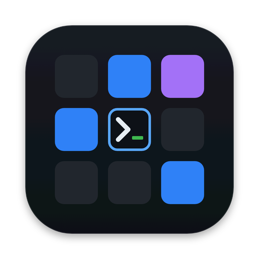
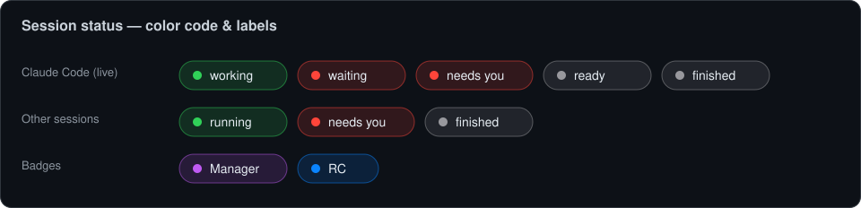

<div align="center">



# Barycenter

**Native macOS mission control for many parallel AI coding agents and terminal sessions.**

Run a fleet of **Claude Code**, Codex, Gemini CLI, Aider (or any CLI) side by side;
see what each is doing at a glance, and get pulled in the moment one needs you.

[](#requirements)
[](#requirements)
[](#build--run)
[](LICENSE)
[](#)
[](https://github.com/jojacobsen/barycenter-ide/releases/latest)

**[⬇︎ Download the latest signed & notarized DMG](https://github.com/jojacobsen/barycenter-ide/releases/latest)** · [Features](#features) · [Build from source](#build--run)

<!--  -->

</div>

---

> Orchestration-first, not editor-first: the agents do the work; the built-in
> editor / diff / files are there for you to peek in and intervene.

## Features

- **Grid & Focus**: all sessions at once, or one big; click a tile and type.
- **Attention routing**: a session that needs you turns 🔴 with a sound, Dock
  bounce and a macOS banner. For Claude Code this is driven by real **hooks**;
  others use a terminal-bell heuristic.
- **Live status**: busy / waiting (+ reason) / idle, read from
  `claude agents --json` and matched to sessions by PID.
- **Spawn with profiles**: Claude Code · Codex · Gemini CLI · Aider · Shell ·
  custom command, in any folder, optionally in its own **git worktree**.
- **Per-session pages** (tab switcher per tile): **Terminal · Status**
  (model / cost / context) **· Notes · Diff** (`git diff`) **· Files**:
  a mini file browser + editor with **syntax highlighting** and a rendered
  **Markdown preview**, plus recursive filename search.
- **AI Manager** (the *Control Center*): an AI manager — itself a Claude session —
  that controls Barycenter via a tiny local command (`baryctl`): list / spawn /
  send / focus / close, and it maintains your shared todo list (notes / note-add /
  notes-set).
- **Activity rail**: toggle **Sessions**, **Manager** and **History** (cross-repo
  git history); two tools split the panel 50/50.
- **Shared notes / todo list** as a Markdown file with an edit/preview switch and
  clickable checkboxes — editable by you and the AI Manager alike.
- **Remote Control** toggle & badge for Claude sessions, themes, and a dark,
  modern UI throughout.

## Quick start

1. **Open Barycenter.** On first launch it offers to load a saved *layout* or
   start empty.
2. **New session** — `⌘T` (or the ＋ button). Pick a **folder** and a **profile**
   (Claude Code · Codex · Gemini CLI · Aider · Shell · custom), optionally in its
   own **git worktree**, and — for Claude — optionally *resume the last
   conversation* (`-c`).
3. **Watch the fleet.** The **Grid** (`⌘1`) shows every session at once; **Focus**
   (`⌘2`) blows one up. A session that needs you turns 🔴 with a sound, a Dock
   bounce and a macOS banner. Click any tile to jump in and type.
4. **Per-tile tabs.** Each tile switches between **Terminal · Status** (model /
   cost / context + an AI *Generate*-on-demand project overview) **· Notes · Diff ·
   Files**.
5. **Left activity rail.** Toggle **Sessions**, **Manager** (the AI Control Center)
   and **History**. Two tools split the panel 50/50.
6. **Shared todo list.** Expand **NOTES** at the bottom of the sidebar, switch
   between the Markdown editor and the rendered preview, and tick checkboxes
   directly — the AI Manager edits the same list.
7. **Let the AI run the fleet.** Start the **AI Manager** (`⌘M`); it spawns,
   monitors and steers sessions for you via `baryctl`.

## Session status

Every session carries one **color-coded status** that drives the sidebar dot, the
tile border and the menu-bar list — so the frame, the dot and the label can never
disagree.



**Claude Code sessions** merge the live `claude agents --json` status with the
hook/bell signal:

| Label | Color | Meaning |
|-------|-------|---------|
| **working** | 🟢 green | Actively running a task. |
| **waiting** *(+ reason)* | 🔴 red | Blocked on you (e.g. a permission prompt); the reason is shown inline. **Needs you.** |
| **needs you** | 🔴 red | A Stop/Notification hook says it's your turn and you haven't looked yet. **Needs you.** |
| **ready** | ⚪️ gray | Idle — nothing pending. |
| **finished** | ⚪️ gray | The process has exited. |

**Other sessions** (shells, other agents) use the terminal-bell heuristic and the
raw state:

| Label | Color | Meaning |
|-------|-------|---------|
| **running** | 🟢 green | The process is alive. |
| **needs you** | 🔴 red | The terminal rang the bell (`\a`). **Needs you.** |
| **finished** | ⚪️ gray | The process has exited. |

Two extra badges can appear next to the status:

| Badge | Color | Meaning |
|-------|-------|---------|
| **Manager** | 🟣 purple | This session is the AI Manager (the Control Center). |
| **RC** | 🔵 blue | Remote Control is enabled for this Claude session. |

## Settings

Open with `⌘,` (**Barycenter → Settings…**). Everything takes effect immediately
(except the UI language, which needs a restart).

| Setting | Options / default | Effect |
|---------|-------------------|--------|
| **Theme** | preset themes | Terminal color theme for **all** session consoles (not the app chrome). |
| **Font** | monospace fonts | Terminal font. |
| **Size** | 9–24 pt | Terminal font size. |
| **Language** | System / Deutsch / English / Español / Français / Italiano / 日本語 / 简体中文 | UI language (**restart required**). |
| **Notes in the sidebar** | on / off | Show the shared notes / todo list at the bottom of the sidebar. |
| **Line numbers in the editor** | on *(default)* / off | Line numbers in the file editor. |
| **Show AI manager** | on *(default)* / off | When off, hides the **Manager** rail button and greys out *Start AI manager*. |
| **Notify when a session is done** | on *(default)* / off | Master switch for attention alerts — sound **+** banner **+** Dock bounce. Off = fully silent. |
| **Sound** | *Off* + all macOS system sounds | The tone played when a session needs you; picking one **previews** it. |

## Requirements

- macOS 13+
- Swift 6 / Xcode 16+ (`swift` toolchain)
- The [`claude`](https://docs.claude.com/en/docs/claude-code) CLI for Claude Code
  sessions (optional for plain shells / other agents)

## Build & Run

```bash
# Run directly
swift run

# …or build a signed .app bundle and open it
./build_app.sh
open Barycenter.app
```

`build_app.sh` assembles `Barycenter.app`, copies the SwiftPM resource bundles
(Highlightr, SwiftTerm, marked/CSS) into it, and ad-hoc signs it.

## How it works (short)

- Each session is a real process in its own PTY, embedded via **SwiftTerm**.
- Claude sessions are launched with per-session **hooks + statusLine** injected
  through `--settings` (no changes to your global config), writing to a local
  file that Barycenter watches → that's the attention/status channel.
- The **AI Manager** drives the app through a local Unix-domain socket; `baryctl`
  (auto-generated at runtime) is the thin client it calls from its shell tool.

## Releases (signed DMG)

Prebuilt, **Developer ID–signed and Apple-notarized** builds are on the
[**Releases**](https://github.com/jojacobsen/barycenter-ide/releases/latest) page:
download `Barycenter.dmg`, drag the app into Applications, and open it (no Gatekeeper
warnings).

To build one yourself:

```bash
./release.sh
```

One-time prerequisites: a *Developer ID Application* certificate in your login
keychain and a `notarytool` credential profile:

```bash
xcrun notarytool store-credentials "barycenter-notary" \
  --apple-id "<apple-id>" --team-id "<TEAM_ID>"
```

`release.sh` re-signs the app with Hardened Runtime (+ a JIT entitlement for
JavaScriptCore/WebKit), builds the DMG via `hdiutil`, notarizes and staples it.

> ⚠️ Early-stage / work in progress; expect rough edges.

## License

[MIT](LICENSE). Third-party components and their licenses are listed in
[THIRD_PARTY_NOTICES](THIRD_PARTY_NOTICES.md). Not affiliated with Anthropic.
